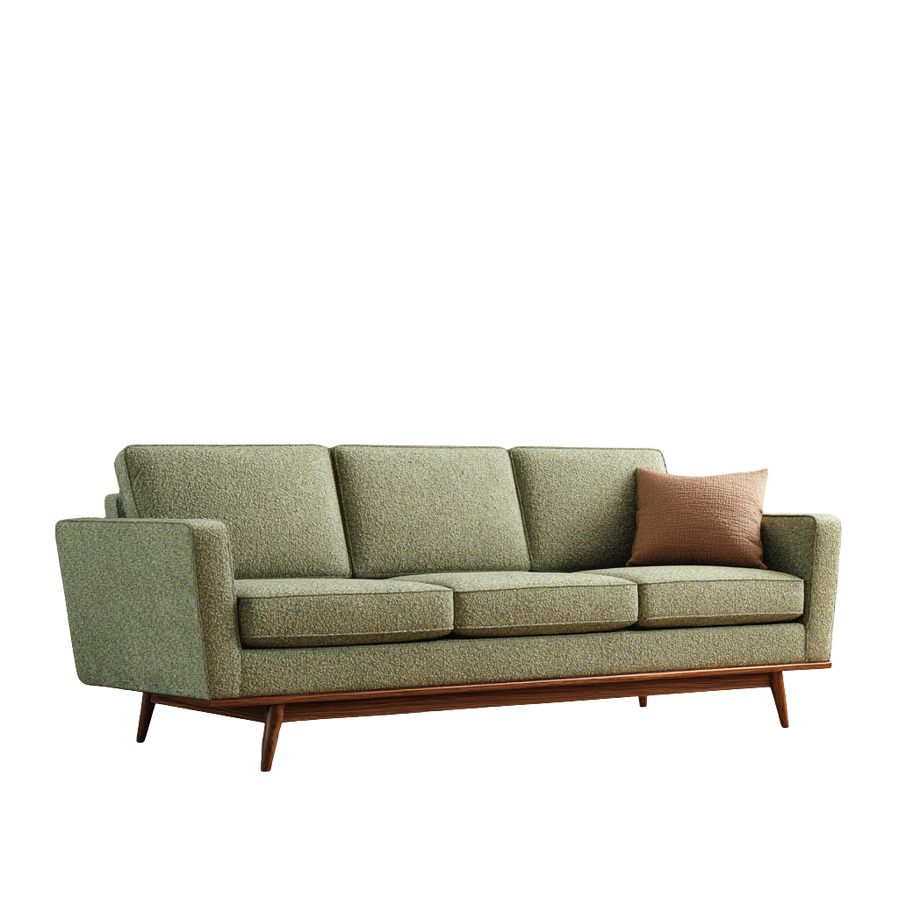
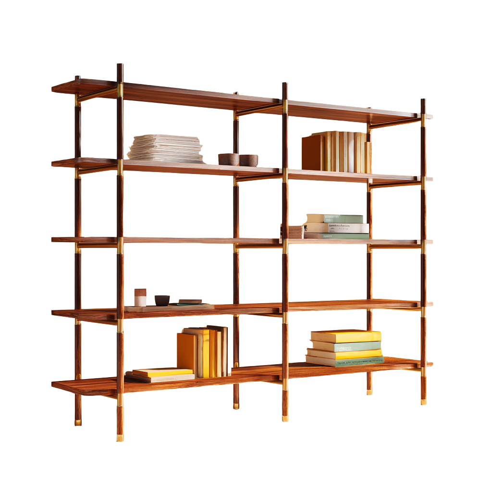
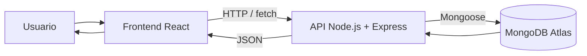

<div align="center">


# 🪑 E-commerce Mueblería Hermanos Jota

### Aplicación web Full Stack · React + Node.js + Express + MongoDB


**Proyecto académico desarrollado durante los Sprints 3 a 6.**

</div>

---

## 🌐 Deploy

| Parte | Plataforma | Enlace |
|---|---|---|
| Frontend | Vercel | https://muebleria-hermanos-jota-sigma.vercel.app |
| API | Render | https://muebleria-hermanos-jota-api-amz5.onrender.com/api/productos |

> [!NOTE]
> La API usa el plan gratuito de Render: después de 15 minutos sin uso se apaga y el primer pedido puede tardar cerca de un minuto en responder.

---

## 📖 Descripción

**Mueblería Hermanos Jota** es una aplicación web de e-commerce desarrollada con una arquitectura separada entre **frontend** y **backend**.

El sistema permite consultar un catálogo de muebles, ver el detalle de cada producto, gestionar un carrito de compras y administrar los productos (crear, editar y eliminar). La interfaz está hecha con **React** y **React Router**; el backend usa **Node.js + Express** y guarda los productos en **MongoDB Atlas** mediante **Mongoose**.

---

## 🖼️ Vista del catálogo

<p align="center">
  
  
  
</p>

> Las imágenes utilizadas forman parte de los recursos del propio proyecto.

---

## ✨ Funcionalidades principales

- 🛍️ Catálogo de productos leído desde MongoDB
- 🔎 Detalle de cada producto en su propia URL (`/productos/:id`)
- ➕ Alta de productos desde un formulario controlado
- ✏️ Edición de productos con los datos actuales precargados
- 🗑️ Eliminación de productos con confirmación
- 🛒 Carrito de compras: agregar, modificar cantidades, quitar y vaciar
- 🧭 Navegación con React Router y página 404
- ⚠️ Estados de carga y mensajes de error en español
- 🔗 Integración entre frontend y backend con URL de la API centralizada

---

## 🛠️ Tecnologías utilizadas

### Frontend

- **React 19**
- **React Router DOM 7**
- **JavaScript**
- **CSS**
- Fetch API
- React Scripts (Create React App)

### Backend

- **Node.js**
- **Express.js 5**
- **MongoDB Atlas + Mongoose**
- **CORS**
- **dotenv**
- API REST

---

## 🏗️ Arquitectura

El proyecto está organizado en dos aplicaciones independientes:

```text
muebleria-hermanos-jota/
│
├── client/                     # Aplicación frontend en React
│   ├── public/
│   │   └── img/                # Imágenes y recursos visuales
│   ├── src/
│   │   ├── components/         # Navbar, ProductCard, ProductForm, Cart...
│   │   ├── pages/              # Una página por ruta
│   │   ├── hooks/              # useProductos
│   │   ├── services/           # productos.js: todas las llamadas a la API
│   │   ├── utils/              # formatPrice, imagenProducto
│   │   ├── App.js              # Rutas y estado del carrito
│   │   └── App.css
│   ├── .env.example
│   └── package.json
│
├── backend/                    # API REST en Node.js + Express
│   ├── config/db.js            # Conexión a MongoDB
│   ├── models/Product.js       # Esquema de Mongoose
│   ├── controllers/            # Lógica de cada endpoint
│   ├── routes/
│   ├── middlewares/            # logger, notFound, errorHandler
│   ├── scripts/                # Migración de los productos iniciales
│   ├── data/productos.js       # Datos originales (solo los usa la migración)
│   ├── server.js
│   ├── .env.example
│   └── package.json
│
└── README.md
```

### Flujo de comunicación



---

## 🚀 Instalación y ejecución

### Requisitos previos

- **Node.js** y **npm**
- Una base de datos en **MongoDB Atlas** (o un MongoDB local)

### 1. Clonar el repositorio

```bash
git clone https://github.com/gianellaromero/muebleria-hermanos-jota.git
cd muebleria-hermanos-jota
```

### 2. Configurar las variables de entorno

Cada carpeta tiene un `.env.example`. Hay que copiarlo como `.env` y completar los valores. Los archivos `.env` no se suben a GitHub.

**`backend/.env`**

| Variable | Descripción | Ejemplo |
|---|---|---|
| `PORT` | Puerto de la API | `3001` |
| `MONGODB_URI` | Cadena de conexión de MongoDB Atlas (se copia desde Atlas → Connect → Drivers) | `mongodb+srv://<usuario>:<contraseña>@<cluster>/muebleriaJota` |
| `FRONTEND_URL` | Frontends habilitados por CORS (separados por coma) | `http://localhost:3000` |

**`client/.env`**

| Variable | Descripción | Ejemplo |
|---|---|---|
| `REACT_APP_API_URL` | URL base de la API, sin `/` al final | `http://localhost:3001` |

> [!NOTE]
> Create React App solo lee las variables que empiezan con `REACT_APP_`, y las lee al iniciar: después de cambiarlas hay que reiniciar `npm start`.

#### Variables en producción

En el deploy, las mismas variables se cargan en el panel de cada plataforma (no se usan archivos `.env`):

| Plataforma | Dónde | Variable | Valor |
|---|---|---|---|
| Render (backend) | Environment → Environment Variables | `MONGODB_URI` | La cadena de conexión de Atlas |
| | | `FRONTEND_URL` | `https://muebleria-hermanos-jota-sigma.vercel.app` |
| | | `NODE_VERSION` | `22` |
| Vercel (frontend) | Settings → Environment Variables | `REACT_APP_API_URL` | `https://muebleria-hermanos-jota-api-amz5.onrender.com` |

- En Render no hace falta `PORT`: la plataforma asigna el puerto sola.
- En Atlas, **Network Access** tiene que permitir `0.0.0.0/0`, porque Render no tiene una IP fija.
- Configuración de cada servicio: Render usa Root Directory `backend`, `npm install` y `npm start` (ver `render.yaml`); Vercel usa Root Directory `client` y el preset Create React App (`client/vercel.json` evita el 404 al recargar las rutas).
- Si se cambia `REACT_APP_API_URL` en Vercel, hay que hacer **Redeploy**, porque React la incluye al compilar.

### 3. Iniciar el backend

```bash
cd backend
npm install
npm run migrar:productos   # solo la primera vez: carga los productos iniciales en MongoDB
npm run dev                # o npm start
```

> [!WARNING]
> `npm run migrar:productos` borra los productos de la colección antes de cargar los iniciales.

La API queda en `http://localhost:3001` y los productos en `http://localhost:3001/api/productos`.

### 4. Iniciar el frontend

En una nueva terminal:

```bash
cd client
npm install
npm start
```

El frontend se ejecuta en `http://localhost:3000`.

> [!IMPORTANT]
> El backend debe estar activo y conectado a MongoDB para que el frontend pueda obtener los productos.

### 5. Correr los tests del frontend

```bash
cd client
npm test
```

---

## 🔗 API REST

Base: `/api/productos`

| Método | Ruta | Descripción | Respuesta OK |
|---|---|---|---|
| `GET` | `/api/productos` | Lista todos los productos | `200` |
| `GET` | `/api/productos/:id` | Devuelve un producto | `200` |
| `POST` | `/api/productos` | Crea un producto | `201` |
| `PUT` | `/api/productos/:id` | Actualiza un producto | `200` |
| `DELETE` | `/api/productos/:id` | Elimina un producto | `200` |

**Errores:** todas las respuestas de error tienen el formato `{ "error": "mensaje" }`.

| Código | Cuándo |
|---|---|
| `400` | El id no es un ObjectId válido, o faltan datos / hay datos inválidos en el body |
| `404` | El producto no existe, o la ruta no existe |
| `500` | Error interno del servidor |

### Modelo `Product`

| Campo | Tipo | Obligatorio | Valor por defecto |
|---|---|---|---|
| `nombre` | String | ✅ | — |
| `precio` | Number (≥ 0) | ✅ | — |
| `descripcion` | String | | `""` |
| `stock` | Number (≥ 0) | | `0` |
| `imagenUrl` | String | | `""` |
| `categoria` | String | | `""` |

Además, MongoDB agrega `_id`, `createdAt` y `updatedAt`. En las respuestas JSON también se incluye `id` (el mismo `_id` como texto), que es el que usa el frontend.

Ejemplo de body para `POST` o `PUT`:

```json
{
  "nombre": "Mesa Ratona Delta",
  "categoria": "Mesas",
  "descripcion": "Mesa baja de madera",
  "precio": 185000,
  "stock": 4,
  "imagenUrl": "/img/mesa-de-centro-araucaria.png"
}
```

---

## 🧭 Rutas del frontend

| Ruta | Página |
|---|---|
| `/` | Inicio |
| `/productos` | Catálogo |
| `/productos/:id` | Detalle del producto (con botones Editar y Eliminar) |
| `/carrito` | Carrito de compras |
| `/contacto` | Formulario de contacto |
| `/admin/crear-producto` | Alta de producto |
| `/admin/editar-producto/:id` | Edición de producto |
| `*` | Página 404 |

---

## 💡 Decisiones de desarrollo

- **Separación frontend / backend:** cada aplicación tiene sus dependencias y su `.env`, lo que permite desplegarlas por separado.
- **Controllers y errores centralizados:** las rutas solo indican qué función atiende cada pedido; los errores se pasan con `next()` a un único `errorHandler` que responde siempre con el mismo formato.
- **Un solo nombre para cada campo:** el modelo de Mongoose es la referencia. El frontend usa los mismos campos (`id`, `descripcion`, `imagenUrl`, `categoria`) en todos los componentes.
- **URL de la API centralizada:** todas las llamadas pasan por `client/src/services/productos.js`, que lee `REACT_APP_API_URL`. Para el deploy solo hay que cambiar esa variable.
- **Formulario reutilizable:** `ProductForm` se usa tanto para crear como para editar.
- **Catálogo siempre actualizado:** la lista se vuelve a pedir cada vez que se entra a `/productos`, así se ven los cambios de crear, editar o eliminar.
- **CORS:** solo se aceptan pedidos de los orígenes listados en `FRONTEND_URL`.

---

## 👥 Equipo

| Integrante |
|---|
| Gianella Romero |
| Daiana Elizabeth Villagra |
| Francisco Garcia Sorrenti |
| Khiara Razzolini |
| Joaquín González |

---

## 📌 Estado del proyecto

| Etapa | Objetivo | Estado |
|---|---|---|
| Sprint 3 | Desarrollo de API backend | ✅ Completado |
| Sprint 4 | Integración Frontend / Backend | ✅ Completado |
| Sprint 5 | MongoDB, React Router y alta de productos | ✅ Completado |
| Sprint 6 | CRUD completo desde React | ✅ Completado |
| Sprint 6 | Deploy (Render + Vercel) | ✅ Completado |

---

## 🎓 Proyecto académico

Proyecto desarrollado con fines académicos dentro de la formación **Full Stack – Santander / ITBA**, aplicando conceptos de:

- Desarrollo web con React y React Router
- Arquitectura cliente-servidor
- APIs REST y CRUD
- Node.js y Express
- MongoDB y Mongoose
- Integración frontend-backend
- Organización de código mediante componentes

---

<div align="center">

### 🪑 Mueblería Hermanos Jota

**React · JavaScript · Node.js · Express · MongoDB**

Proyecto académico · 2026

</div>
